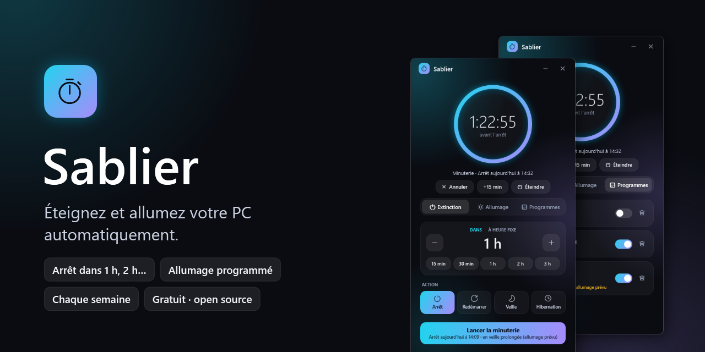
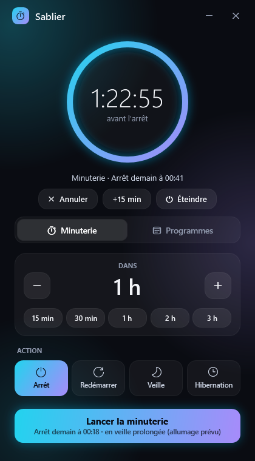
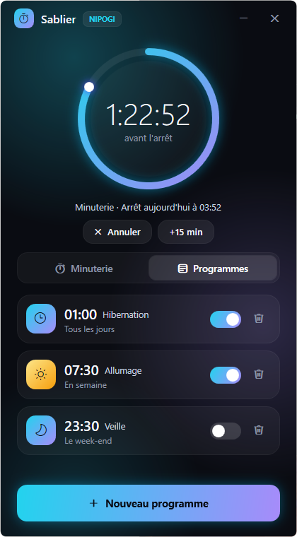
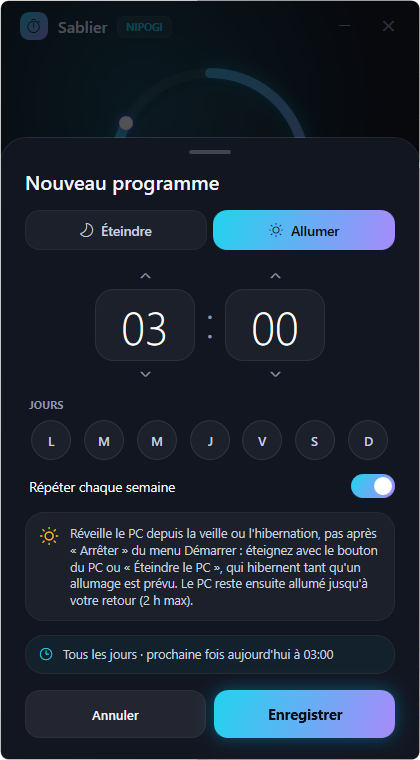
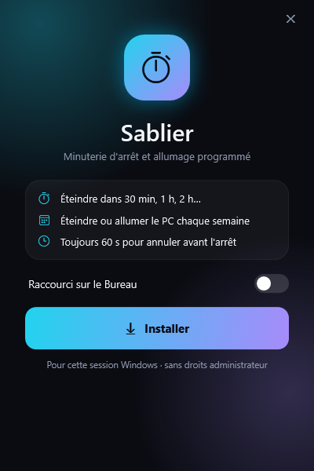
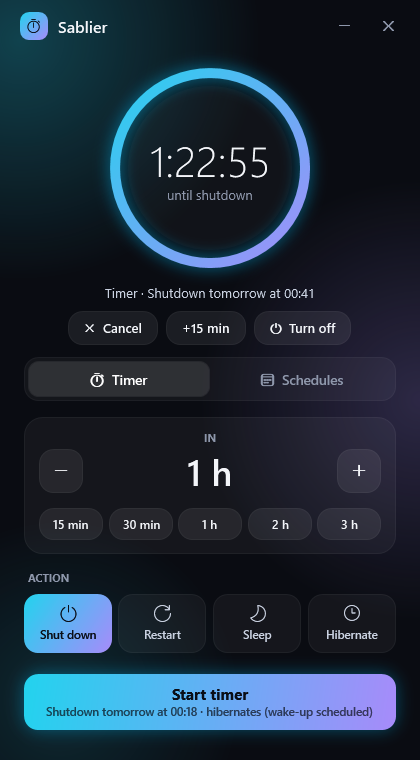
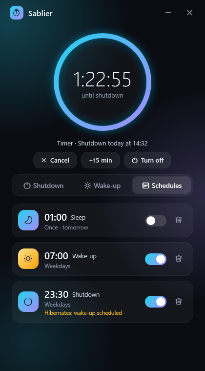
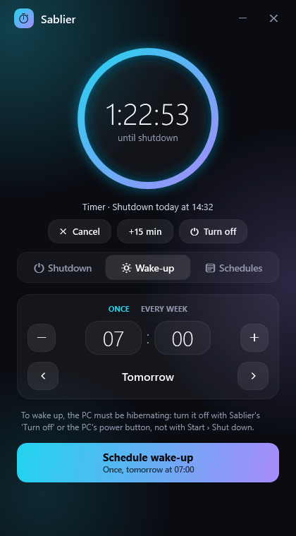

<p align="center"></p>

# Sablier

**Éteignez et allumez votre PC automatiquement.** Sablier est un petit utilitaire Windows, gratuit et open source, pour programmer l'arrêt de votre PC dans X heures, ou l'éteindre et l'allumer à heure fixe, une fois ou chaque semaine. Interface moderne et animée, en français ou en anglais selon la langue de Windows, 119 Ko, sans droits administrateur.

*[English below](#english)*

<p align="center">
  <a href="https://github.com/mario07teck-sys/Sablier/releases/latest/download/Sablier-Setup.exe"><b>⬇ Télécharger Sablier pour Windows 10 / 11</b></a>
</p>

## Ce que fait Sablier

- **Minuterie** : « éteindre dans 30 min, 1 h, 2 h… » en un clic, avec arrêt, redémarrage, veille ou hibernation.
- **Programmes** : éteindre ou allumer le PC à une heure précise, une seule fois ou certains jours de la semaine (en semaine, le week-end, tous les jours…).
- **Allumage programmé** : le PC sort de veille ou d'hibernation à l'heure voulue et reste allumé jusqu'à votre retour.
- **Toujours 60 secondes pour annuler** : une alerte animée prévient avant chaque arrêt (Annuler, +15 min, Maintenant).
- **Malin avec l'allumage** : tant qu'un allumage est prévu, le bouton d'alimentation du PC, « Éteindre le PC », les arrêts programmés et les minuteries « Arrêt » passent en hibernation, pour que le PC puisse se rallumer. Sinon, ils éteignent normalement.
- **Zone de notification** : fermez Sablier pendant qu'une extinction, une minuterie ou un allumage est prévu, son icône reste près de l'horloge. Au survol, le temps restant ; clic pour le rouvrir ; clic droit pour ouvrir Sablier, annuler la minuterie ou quitter. S'il ne reste rien de prévu, Sablier se ferme vraiment. À l'ouverture de session, il s'y range si quelque chose est prévu.
- **Léger et fiable** : chaque programme est une tâche du Planificateur de tâches Windows. L'extinction et l'allumage ont donc lieu même si Sablier est fermé. Processeur (mesuré sur la 1.2) : environ 1,5 % d'un cœur au premier plan, 0,3 % en arrière-plan, rien de mesurable dans la zone de notification.

<p align="center">
  
  
  
</p>
<p align="center">
  
  
</p>

## Installation

1. Téléchargez [`Sablier-Setup.exe`](https://github.com/mario07teck-sys/Sablier/releases/latest/download/Sablier-Setup.exe).
2. Ouvrez-le et cliquez sur **Installer**. Pas besoin d'être administrateur ; Sablier s'ajoute au menu Démarrer (et au Bureau si vous le souhaitez).
3. Relancer le fichier plus tard installe la mise à jour. Installation silencieuse : `Sablier-Setup.exe --silent`.

> **« Windows a protégé votre ordinateur » ?** Sablier n'est pas signé numériquement (un certificat coûte plusieurs centaines d'euros par an). Cliquez sur **Informations complémentaires** puis **Exécuter quand même**. Le code source complet est ici, vous pouvez le lire ou compiler l'exe vous-même.

Pour désinstaller : *Paramètres › Applications › Applications installées › Sablier*. Tout est retiré : programmes, raccourcis, et réglages d'alimentation remis comme avant.

## Bon à savoir sur l'allumage programmé

Windows ne peut réveiller un PC que s'il est **en veille ou en hibernation**, pas après un arrêt complet. Pour éteindre quand un allumage est prévu, utilisez :

- le bouton **« Éteindre »** sous l'horloge de Sablier, ou **« Éteindre le PC »** (menu Démarrer, ou clic droit sur Sablier épinglé à la barre des tâches),
- le **bouton d'alimentation** du PC (Sablier le règle sur « hibernation » le temps que l'allumage est prévu, puis le remet comme avant).

Les arrêts programmés et les minuteries « Arrêt » hibernent eux aussi. Après avoir enregistré un allumage, Sablier vous explique comment éteindre pour qu'il ait lieu.

L'« Arrêter » du menu Démarrer de Windows fait un arrêt complet : l'allumage n'aura pas lieu. Le réglage « Autoriser les minuteurs de sortie de veille » doit être activé ; Sablier s'en charge.

Un allumage **une seule fois** se supprime de lui-même une fois passé.

## Questions fréquentes

- **Mes données ?** Sablier ne collecte rien et ne se connecte jamais à Internet.
- **Et si je suis en train de travailler ?** L'arrêt n'est jamais forcé : une application avec un travail non enregistré peut le bloquer, et l'alerte de 60 s laisse le temps d'annuler.
- **Où sont mes programmes ?** Dans le Planificateur de tâches Windows, dossier `\Sablier`.

## Compiler soi-même

Aucun SDK à installer : le compilateur C# fourni avec Windows suffit.

```powershell
git clone https://github.com/mario07teck-sys/Sablier
cd Sablier
.\build.ps1      # produit dist\Sablier-Setup.exe
```

WPF sur .NET Framework 4.8 (présent sur tout Windows 10/11). `Sablier.exe --selftest` lance l'auto-test.

## Soutenir le projet

Sablier est gratuit. S'il vous rend service, une ⭐ sur ce dépôt aide d'autres personnes à le trouver.

*Sablier a été conçu avec l'aide d'un assistant IA (Claude).*

---

## English

**Turn your PC off and on automatically.** Sablier ("hourglass" in French) is a small, free and open-source Windows 10/11 utility: shut down your PC in X hours, or turn it off and wake it up at set times, once or on chosen weekdays. Modern animated UI in English or French (follows your Windows language), 119 KB, no admin rights.

<p align="center"><a href="https://github.com/mario07teck-sys/Sablier/releases/latest/download/Sablier-Setup.exe"><b>⬇ Download Sablier for Windows 10 / 11</b></a></p>

- **Timer**: shut down, restart, sleep or hibernate in 30 min, 1 h, 2 h… in one click.
- **Schedules**: turn the PC off or wake it up at a set time, once or on chosen days.
- **Scheduled wake-up**: the PC wakes from sleep or hibernation on its own and stays on until you're back.
- **Always 60 seconds to cancel** before any shutdown (Cancel, +15 min, Now).
- **Adapts to wake-ups**: while a wake-up is scheduled, the power button, the "Shut down PC" shortcut, scheduled shutdowns and "Shut down" timers hibernate instead of shutting down, so the PC can wake up again. Otherwise they shut down normally.
- **Notification area**: close Sablier while a shutdown, timer or wake-up is scheduled and its icon stays near the clock. Hover to see the time left; click to reopen; right-click to open Sablier, cancel the timer or quit. If nothing is left scheduled, Sablier really closes. At sign-in, it moves there if something is scheduled.
- **Lightweight and reliable**: each schedule is a Windows Task Scheduler task, so shutdowns and wake-ups happen even when Sablier is closed. CPU (measured on 1.2): about 1.5 % of one core in the foreground, 0.3 % in the background, nothing measurable in the notification area. No data collected, no internet connection.

<p align="center">
  
  
  
</p>

**Install**: download `Sablier-Setup.exe`, open it, click **Install**. If Windows shows "Windows protected your PC", click **More info › Run anyway**: the exe isn't code-signed (a certificate costs hundreds of euros a year), and the full source code is right here. Uninstall from *Settings › Apps › Installed apps*. Silent install: `Sablier-Setup.exe --silent`.

**Good to know**: Windows can only wake a PC from sleep or hibernation, not after a full shutdown. While a wake-up is scheduled, turn the PC off with the "Turn off" button under the clock, the power button or "Shut down PC"; the Start menu's "Shut down" does a full shutdown and the wake-up won't happen. A one-time wake-up deletes itself once it has happened.

Sablier was built with the help of an AI assistant (Claude). Licensed under [MIT](LICENSE).
